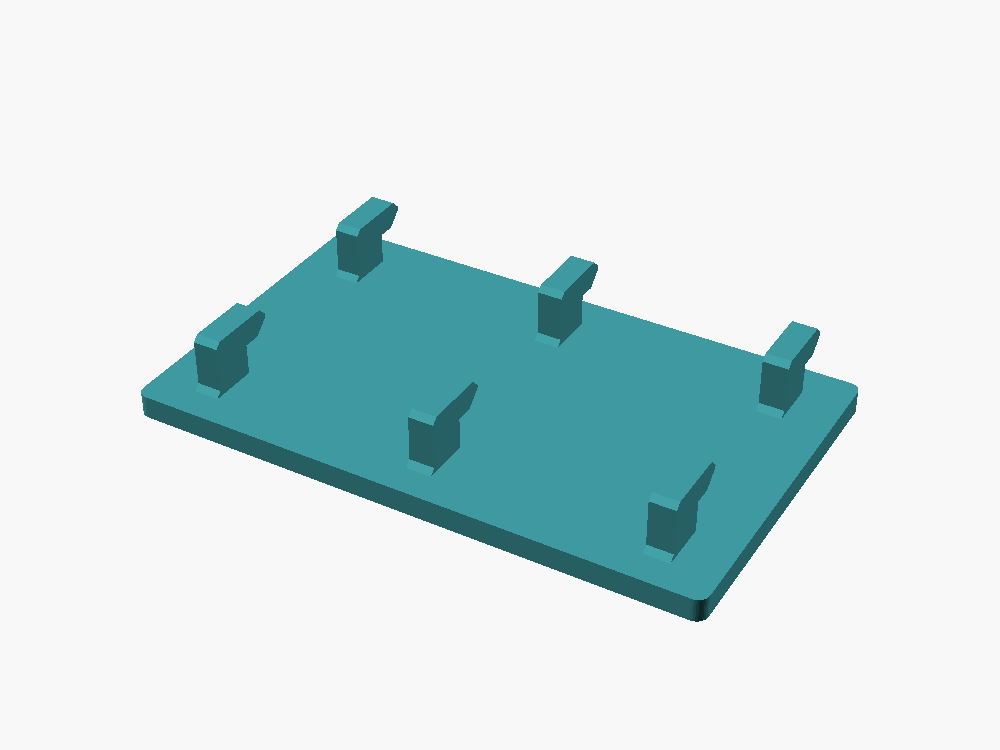
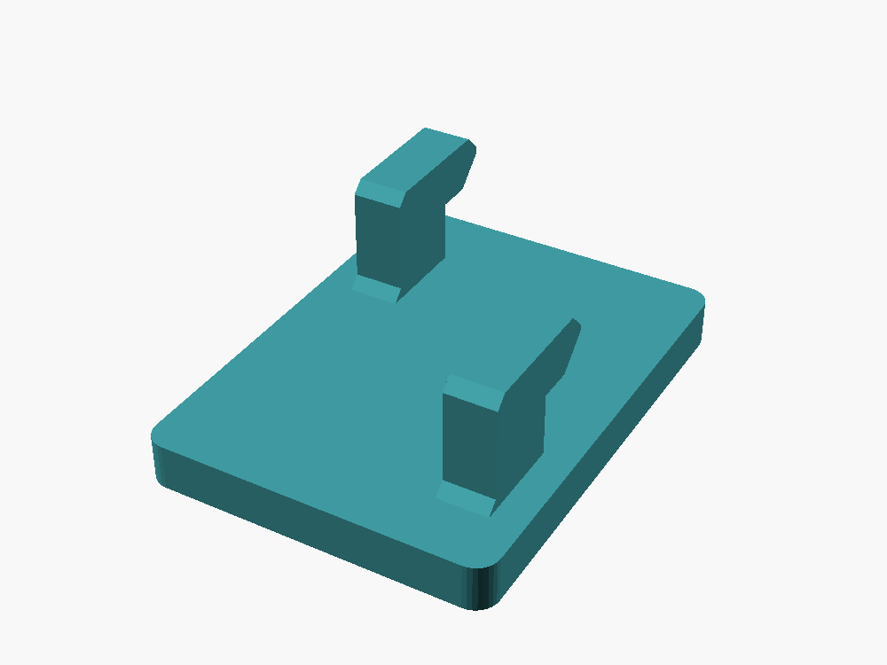
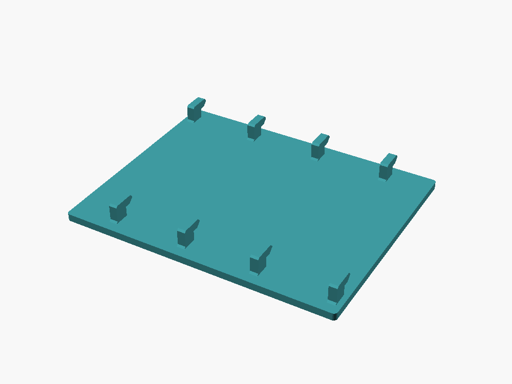
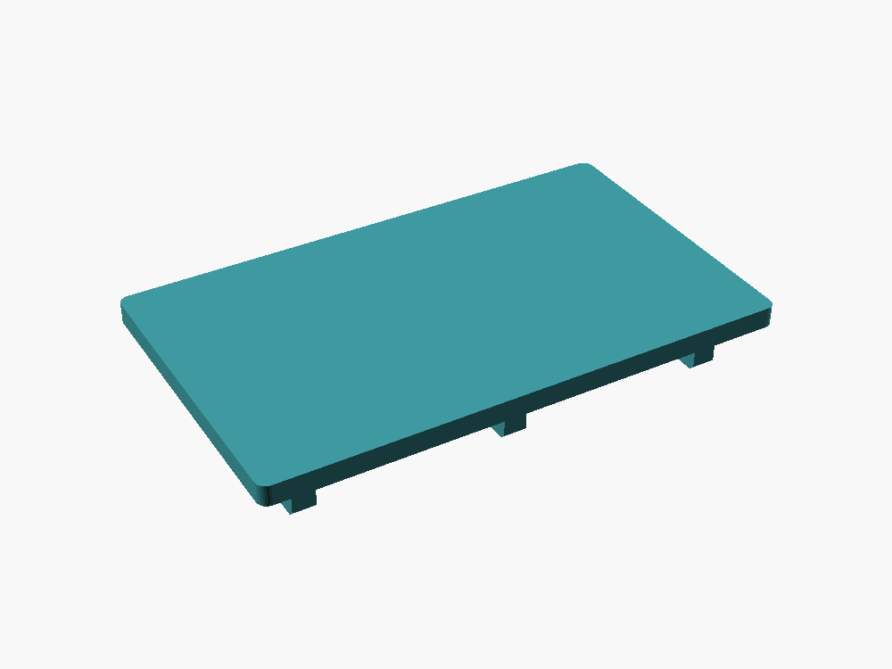
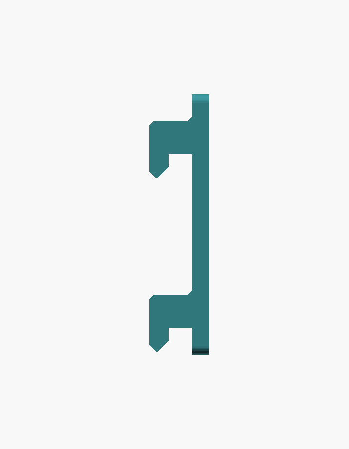
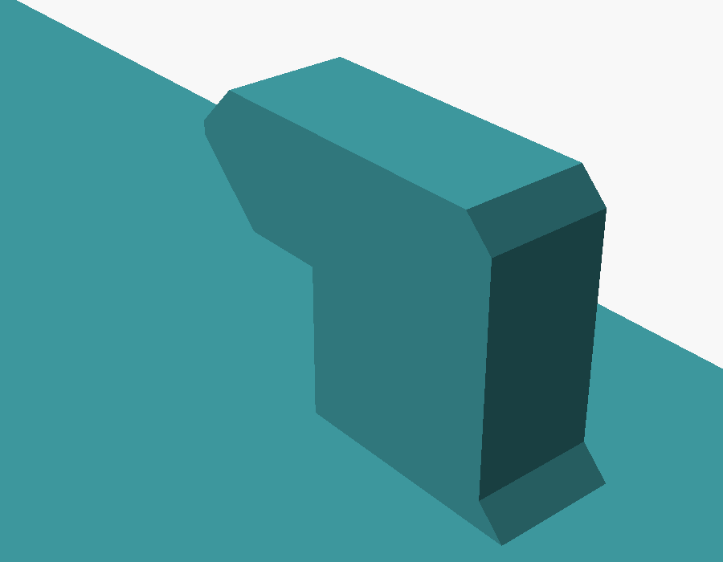

# Parametric SKÅDIS Flat Mount

An OpenSCAD model of a flat plate that hangs on an IKEA SKÅDIS pegboard, with a smooth front face for double-sided tape.

## Parameters

Open `skadis_flat_mount.scad` in OpenSCAD and use the Customizer:

| Parameter     | Description                               | Default | Range  |
|---------------|-------------------------------------------|---------|--------|
| `face_width`  | Width of the tape face (mm)               | 60      | 20–400 |
| `face_height` | Height of the tape face (mm)              | 60      | 20–400 |
| `face_depth`  | Thickness of the face plate (mm)          | 4       | 2–15   |
| `supports`    | Add breakaway supports under hook lips    | off     |        |

## How many hooks?

The number of hooks is worked out from the face size. Hooks go in every SKÅDIS slot in the top and bottom rows that fits behind the plate, centred on the plate. The top hooks carry the load and the bottom hooks stop the plate from swinging. The hook count is printed to the console.

| 30 × 40 mm — 2 hooks | 150 × 120 mm — 8 hooks |
|---|---|
|  |  |

The front is a plain flat surface for the tape:

## Hook profile

Each hook passes straight through a slot, then the plate slides down about 5 mm so the lip catches behind the board.

| Side profile | Hook close-up |
|---|---|
|  |  |

## Printing

The model is already in print orientation: tape face down, hooks pointing up. This gives the smoothest tape face, and the other orientations need more support, not less.

Each lip has a 3 mm flat section that catches behind the board, and the rest slopes at 45° so it prints on its own. The only unsupported overhang is that 3 mm flat section, which most printers handle without supports.

If your printer struggles with it, turn on the `supports` option. It adds thin fins under the flat section, with a 0.2 mm gap at the top so they snap off.

## Mounting

Push all the hooks straight into the slots, then slide the plate down about 5 mm until it locks.

## Fit tuning

The hook width (`tab_w`, 4.4 mm) and board gap (`gap`, 5.4 mm) are in the hidden section of the file if the fit on your board is too tight or loose.
